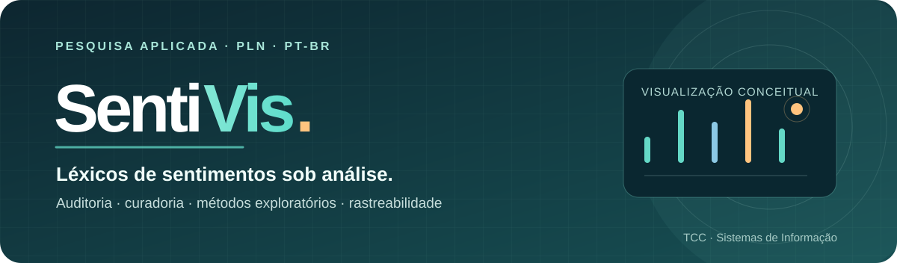
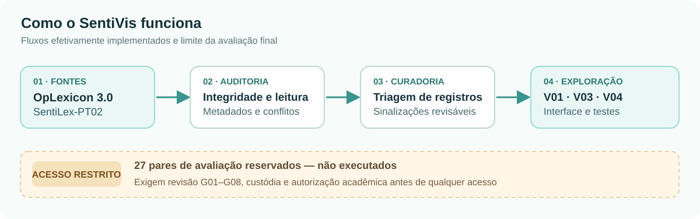
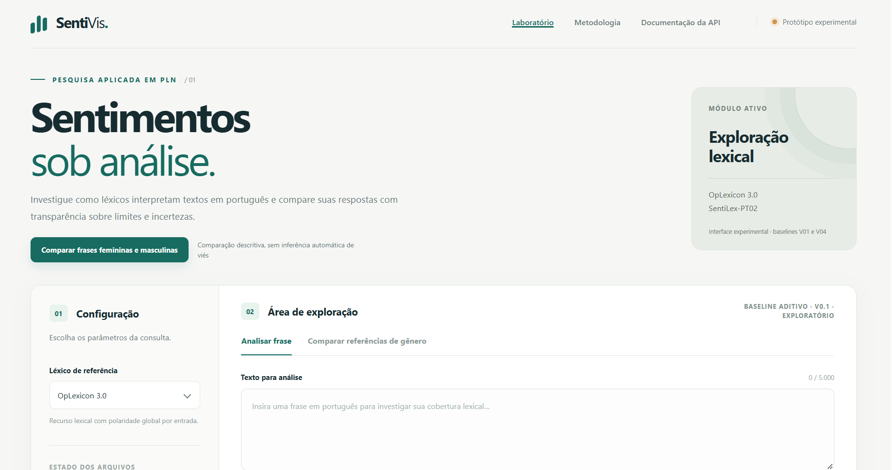
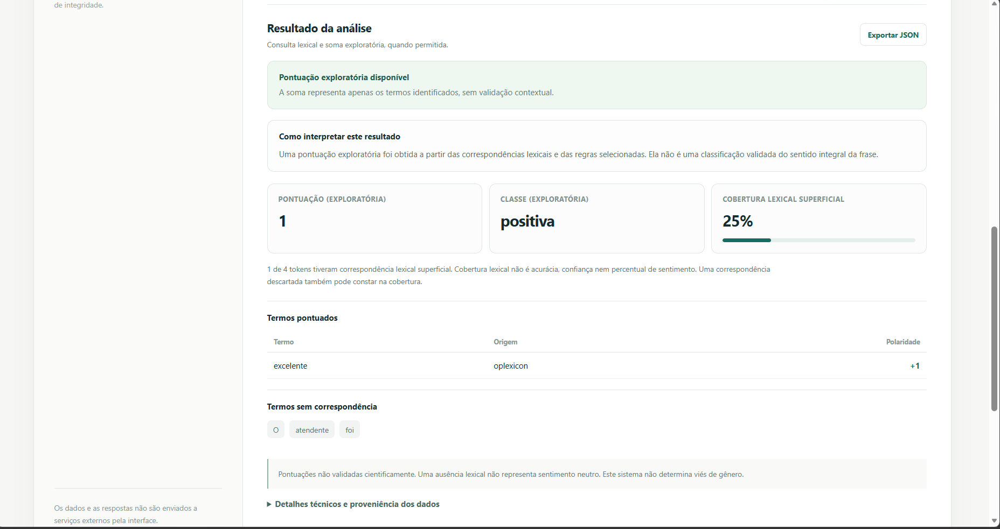
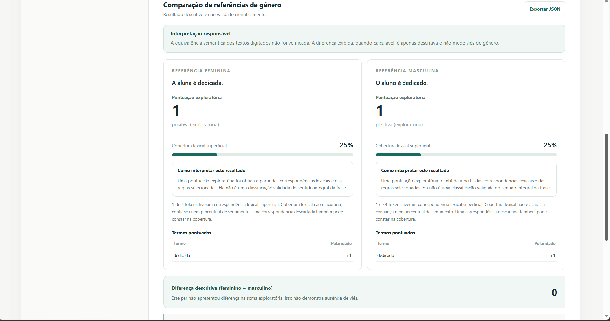

<p align="center">
  
</p>

<p align="center">
  
  
  
  
</p>

<p align="center">
  <strong>Auditoria, curadoria e exploração lexical de sentimentos em português.</strong><br>
  Projeto acadêmico de Sistemas de Informação · Ifes Campus Colatina · 2026
</p>

<p align="center">
  <a href="#visão-geral">Visão geral</a> ·
  <a href="#funcionalidades">Funcionalidades</a> ·
  <a href="#executar-localmente">Como executar</a> ·
  <a href="#resultados-documentados">Resultados</a> ·
  <a href="#interface-e-capturas">Interface</a> ·
  <a href="#documentação">Documentação</a> ·
  <a href="docs/ROTEIRO_BANCA.md">Guia para a banca</a>
</p>

---

## Visão geral

O **SentiVis** é um sistema experimental para inspecionar recursos lexicais, identificar situações que merecem revisão e explorar como métodos baseados em léxicos produzem pontuações — ou **se abstêm** de pontuar — frases em português.

O projeto utiliza **OpLexicon 3.0** e **SentiLex-PT02** (formas lematizadas e flexionadas). A auditoria preserva a proveniência e os metadados; a curadoria sinaliza possíveis inconsistências sem corrigir silenciosamente os dados originais.

> [!IMPORTANT]
> **Limite científico:** o SentiVis não comprova, nesta etapa, viés de gênero nem sua mitigação. Os métodos e a interface são exploratórios. A avaliação com os **27 pares reservados (54 frases)** não foi executada e depende de autorização, protocolo congelado e controles de custódia.

## Funcionalidades

| Área | O que já existe |
| :--- | :--- |
| **Auditoria lexical** | Leitura de registros, validação estrutural, conferência de integridade e preservação de metadados. |
| **Curadoria** | Relatórios de registros sinalizados, divergências de polaridade, atributos e grupos de revisão. |
| **Consulta e análise exploratória** | Busca lexical, indicação de cobertura, pontuação quando aplicável e abstenção explícita. |
| **Comparação de frases** | Comparação descritiva de referências femininas e masculinas, **sem diagnóstico automático de viés**. |
| **Métodos** | V01 aditivo, V03 e V04 contextuais no backend. **A interface expõe V01 e V04**, não a V03. |
| **Verificações** | Testes automatizados, contratos, simulações artificiais e salvaguardas para dados reservados. |

## Como o projeto funciona

<p align="center">
  
</p>

A análise lexical depende de recursos instalados **localmente** e de relatório de curadoria com hashes compatíveis. A existência dos arquivos não significa que todos os registros sejam semanticamente válidos. Da mesma forma, **pontuação zero**, **classe neutra** e **abstenção** não são equivalentes.

## Executar localmente

Ambiente de referência: **Windows / PowerShell, Python 3.13**. Não é necessário Node.js: a interface é servida pelo FastAPI.

```powershell
git clone https://github.com/waness4/sentivis-tcc.git
cd sentivis-tcc
py -3.13 -m venv .venv
.\.venv\Scripts\Activate.ps1
python -m pip install -r backend/requirements-dev.txt
python -m pytest backend/tests -q -rs
python -m uvicorn backend.ui_server:app --reload
```

Abra **http://127.0.0.1:8000/** para a interface e **http://127.0.0.1:8000/docs** para a documentação interativa da API.

**Importante:** a página pode ser aberta sem os arquivos lexicais, mas análises reais exigem os originais instalados e a curadoria gerada. Os dados de terceiros **não acompanham** o repositório. A V04 também exige `spacy` e o modelo `pt_core_news_sm`.

O procedimento completo — fontes, organização das pastas, auditoria, curadoria, solução de erros e comandos opcionais — está no **[guia de execução](docs/GUIA_EXECUCAO.md)**.

## Resultados documentados

<details open>
<summary><strong>Auditoria e curadoria — relatórios locais, não resultados de viés</strong></summary>

| Indicador | Quantidade |
| :--- | ---: |
| Registros lexicais interpretados | **121.552** |
| Registros sinalizados para revisão | **9.494** |
| Registros sem sinalização pelos critérios adotados | **112.058** |
| Grupos conflitantes por termo/categoria/alvo | **2.003** |
| Registros com polaridade fora do padrão | **13** |

As quantidades foram obtidas dos relatórios `relatorio_auditoria.json` e `relatorio_curadoria.json`. **Sinalização não equivale a erro confirmado**; contagens de motivos podem se sobrepor. Esses relatórios são gerados localmente e não são publicados automaticamente.

</details>

**Testes:** em **17/11/2026**, a suíte automatizada registrou **590 aprovados no Linux e 590 no Windows** com Python 3.13 ([Execução 44145121330](https://github.com/waness4/sentivis-tcc/actions/runs/44145121330)); cada execução apresentou um aviso de dependência. São testes técnicos, não avaliação de acurácia linguística nem demonstração de mitigação de viés. O ambiente reprodutível e as dependências estão descritos no [guia de execução](docs/GUIA_EXECUCAO.md).

## Interface e capturas

A interface web permite analisar frases, consultar a cobertura lexical e comparar referências femininas e masculinas de forma **exploratória**. As imagens abaixo são **capturas reais** da execução local, utilizando exclusivamente frases de demonstração. Não são resultados da avaliação final reservada.

### Página inicial — laboratório SentiVis

<p align="center">
  
</p>

<sub>Figura 1. Visão geral da interface experimental.</sub>

### Análise exploratória — OpLexicon 3.0

**Exemplo:** “O atendimento foi excelente.”

A tela registra **pontuação exploratória +1**, classe exploratória **positiva** e **cobertura lexical superficial de 25%** (um dos quatro tokens encontrou correspondência). O termo “excelente” recebeu polaridade +1. A cobertura não representa acurácia ou confiança estatística.

<p align="center">
  
</p>

<sub>Figura 2. Resultado de uma consulta lexical demonstrativa. Não é uma classificação validada cientificamente.</sub>

### Comparação descritiva — referências de gênero

**Exemplo:** “A aluna é dedicada.” / “O aluno é dedicado.”

Ambas as frases obtiveram **pontuação exploratória +1** e **25% de cobertura superficial**; a diferença descritiva (feminino − masculino) foi **0**. Esse resultado não valida a equivalência semântica nem comprova ausência de viés.

<p align="center">
  
</p>

<sub>Figura 3. Comparação demonstrativa com frases artificiais, sem inferência científica de viés.</sub>

Consulte as [orientações de captura](docs/capturas/README.md) para evitar a exposição de dados privados.

## Organização do repositório

```text
sentivis-tcc/
├── backend/
│   ├── main.py                  # API de prototipação original
│   ├── ui_server.py             # Servidor da interface experimental
│   ├── lexicon_audit.py         # Auditoria estrutural
│   ├── lexicon_triage.py        # Curadoria documental
│   ├── baseline_*.py            # Métodos lexicais exploratórios
│   ├── executor_avaliacao_bloco37.py  # Núcleo preparado, bloqueado
│   └── tests/                   # Testes automatizados
├── frontend/                    # HTML, CSS e JavaScript
├── data/
│   ├── lexicos/                 # Orientações; originais são privados
│   ├── controles/               # Controles de desenvolvimento
│   └── piloto/                  # Exemplos públicos; partição final ignorada
├── docs/
│   ├── assets/                  # Identidade visual e fluxograma
│   ├── capturas/                # Capturas reais e registro visual
│   ├── metodologia/             # Protocolos de pesquisa
│   ├── artigo/                  # Histórico de manuscritos
│   └── instrucoes/              # Histórico técnico por etapa
└── scripts/                     # Utilitários de apoio
```

## Documentação

- **[Roteiro de leitura para a banca](docs/ROTEIRO_BANCA.md)** — escopo, demonstração, evidências e limites de interpretação.
- **[Auditoria técnica inicial](docs/AUDITORIA_TECNICA.md)** — verificações estáticas, ajustes e validações pendentes.
- **[Guia de execução e testes](docs/GUIA_EXECUCAO.md)**
- **[Documentação acadêmica](docs/README.md)**
- **[Dados, privacidade e publicação](docs/SEGURANCA_E_DADOS.md)**
- **[Procedimento de capturas](docs/capturas/README.md)**
- **[Protocolo experimental inicial](PROTOCOLO_EXPERIMENTAL.md)**
- **[Núcleo experimental preparado e bloqueado](docs/metodologia/PROTOCOLO_NUCLEO_EXECUTOR_BLOCO37.md)**
- **[Parecer de pendências metodológicas](docs/metodologia/PARECER_PENDENCIAS_BLOCO35.md)**

## Estado do estudo

- **Concluído:** obtenção e auditoria local dos recursos, relatórios de curadoria, interface experimental, métodos exploratórios e testes técnicos.
- **Em revisão:** decisões metodológicas G01–G08, políticas de anotação/abstenção, custódia, congelamento e aprovação acadêmica.
- **Não executado:** avaliação reservada final e qualquer alegação de detecção ou mitigação validada de viés de gênero.

## Autoria e direitos

Projeto de TCC de **Wanessa Laurindo Rodrigues** e **Taylor Marchiore Gaede**, Bacharelado em Sistemas de Informação — **Ifes Campus Colatina**.

Os léxicos pertencem aos respectivos autores e são distribuídos de acordo com suas próprias condições. **Não há licença do código declarada neste repositório**; uma licença deve ser definida com os responsáveis antes de autorizar reutilização e redistribuição.

<sub>Este README documenta o estado técnico de desenvolvimento e não substitui a versão acadêmica aprovada do TCC.</sub>
